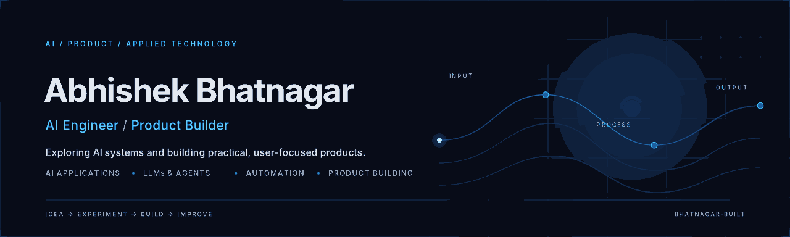
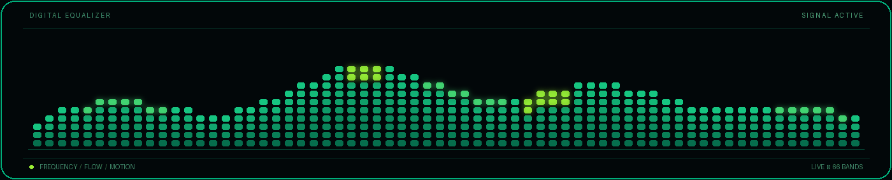
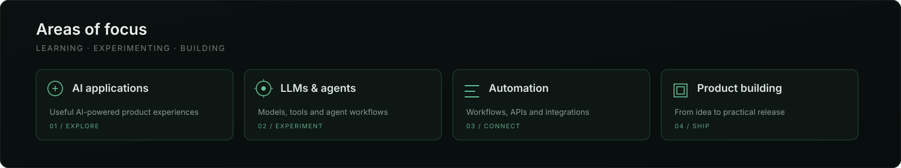
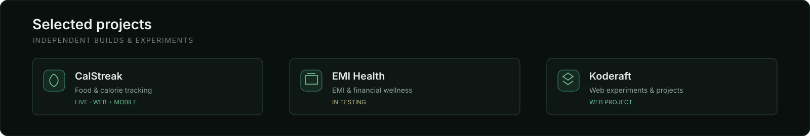
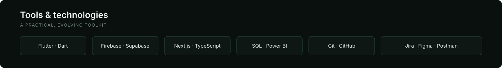

  

  

## About

I explore AI systems and build practical, user-focused products. My interests span AI applications, LLM-powered workflows, automation, product thinking and turning ideas into useful experiences.

  

## Selected projects

  

- **Credalytix** — [Showcase](https://github.com/bhatnagar-built/Credalytix-Working-Capital-Eligibility-Calculator-showcase) · Institutional commercial credit underwriting, 100-point RAM scorecard & MPBF models
- **EMI Health** — [Showcase](https://github.com/bhatnagar-built/emi-health-app-showcase) · [Project](https://emi-health-d408f.web.app/) · Privacy-first debt diagnostics & zero-drift loan amortization mobile app
- **CounselPro** — [Showcase](https://github.com/bhatnagar-built/counselpro-app-showcase) · Modern legal practice management suite & verified advocate matching
- **CalStreak** — [Showcase](https://github.com/bhatnagar-built/CalStreak-Showcase) · [Web app](https://calstreak.web.app/) · [Google Play](https://play.google.com/store/apps/details?id=com.abhishekbhatnagar.calstreak) · Habit-first nutrition & consecutive streak tracking
- **Jeevan Setu** — [Showcase](https://github.com/bhatnagar-built/jeevan-setu-app-showcase) · Privacy-first emergency blood donation platform with in-app WebRTC calling
- **Muscle Power** — [Showcase](https://github.com/bhatnagar-built/muscle-power-app-showcase) · Home and gym workout training application · adaptive hypertrophy & workout planner

## Tools & technologies

  

## Connect

[Portfolio](https://idea-into-impact.firebaseapp.com/) · [GitHub](https://github.com/bhatnagar-built) · [LinkedIn](https://www.linkedin.com/in/abhishek-bhatnagar-44022b131/)

---

Curious by nature. Practical by design.

